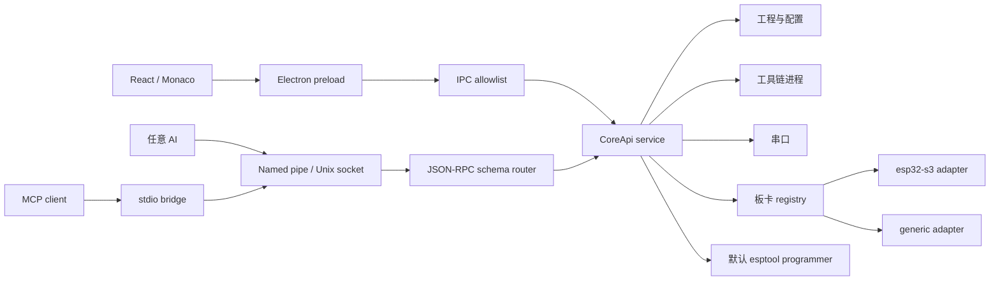

# 模块化架构与扩展约定

Blode Studio 的目标是兼容不同单片机与硬件开发场景。核心进程只处理工程、进程、文件、串口和通用生命周期；芯片事实、编译参数、分区规则和烧录协议放在 `extensions/` 的独立适配目录中。新增硬件优先新增目录，不修改核心流程。

欢迎在 <https://github.com/mioolio/blode> 提交新的板卡、烧录器或补全适配。

## 目录责任

| 目录                         | 唯一责任                                                | 允许依赖                         |
| ---------------------------- | ------------------------------------------------------- | -------------------------------- |
| `src/shared/`                | 跨进程 TypeScript 数据契约与通道常量                    | TypeScript 类型                  |
| `src/core/`                  | Electron 主进程、工程文件、配置、编译、串口与工具链服务 | shared、extensions、Node API     |
| `src/renderer/`              | 多面板界面、Monaco 编辑器、图形配置、国际化             | shared 类型、preload 暴露的 API  |
| `extensions/boards/<model>/` | 单一型号的默认配置、容量、分区与编译参数适配            | shared、extensions/types         |
| `extensions/boards/generic/` | 通用默认板卡配置                                        | shared、extensions/types         |
| `extensions/programmers/`    | 烧录协议命令参数生成                                    | shared、extensions/types         |
| `extensions/completions/`    | 按语言声明的补全、成员补全与悬停数据                    | 纯 TypeScript 数据，无 Node API  |
| `src/automation/`            | 系统管道、标准方法映射、客户端与 MCP 传输适配           | shared、核心配置 schema、CoreApi |
| `scripts/`                   | 开发构建与 MCP 启动入口                                 | 构建工具、automation             |
| `examples/`                  | 可实际编译的示例工程                                    | 板卡 API                         |
| `tests/`                     | 关键协议、边界和数据校验测试                            | 被测模块                         |
| `docs/`                      | 使用、架构、管道与实机验证说明                          | 无运行时依赖                     |

新增功能先确定它的责任目录。板卡目录不得直接创建窗口、调用 shell 或访问前端状态；前端不得导入 Node 的 `fs`、`net`、`child_process`。跨模块通过显式函数与数据契约通信，避免全局可变状态。

## 调用流

`src/shared/contracts.ts` 中的 `CoreApi` 是界面与 AI 的共同能力边界。界面先保存编辑内容，再请求构建；编译和烧录使用磁盘上的已保存工程，避免显示内容与固件内容不一致。`BuildResult` 代表编译工具实测结果，不能把源代码字符数当作固件 Flash 或 RAM 用量。

## 核心服务分工

- `workspace.ts` 负责工程配置落盘、源文件索引及路径边界，拒绝目录穿越和不安全的符号链接/目录联接。
- `config.ts` 定义 Zod schema 并结合分区验证；所有入口复用同一核心校验。
- `partitions.ts` 验证 Flash 范围、对齐和分区重叠。
- `process.ts` 负责带参数数组的进程执行、输出和超时，禁止通过拼接命令注入 shell。
- `serial.ts` 负责端口枚举、打开/关闭及数据事件。
- `toolchain.ts` 负责官方工具链检测和安装，或使用配置中可信的自定义可执行文件。
- `service.ts` 组合上述服务，维护工程状态并实现 `CoreApi`；它不承担界面布局或型号专属参数生成。

Electron 使用 context isolation，preload 只公开能力白名单。板卡信息从 registry 返回数据，renderer 不直接运行扩展代码。当前扩展以 TypeScript 模块静态注册；没有实现任意第三方 JavaScript 插件热加载或沙箱。第三方编译文件可通过受控工具链配置接入，配置来源必须可信。

## 新增一个型号

1. 创建 `extensions/boards/<唯一型号 id>/`，放置 `manifest.json`、`adapter.ts` 和该型号需要的分区等文件。
2. 实现 `extensions/types.ts` 的板卡适配契约，只生成型号参数与默认配置。
3. 在 `extensions/registry.ts` 注册适配器；界面通过 `getState().boards` 获取板卡列表。
4. 为该型号添加容量/分区/参数测试，在该目录 README 记录 Flash、RAM、PSRAM、USB 与串口差异。
5. 在 renderer 的中文、英文 JSON 中添加 manifest 对应的 `descriptionKey`。

通用能力放在 programmer 或 core，不能复制整套核心到每个型号目录。只有型号确实不同的逻辑才放入型号目录。例如 ESP32-S3 的 FQBN、Flash 档位与默认分区属于 S3；Windows 串口枚举属于 core；esptool 参数属于 programmer。

## 编译、容量与布局

内置配置选择官方稳定 Arduino CLI 与 Espressif ESP32 核心；安装时解析当时的官方稳定版本，安装后的实际版本可读取。版本不是硬编码的“永远最新”，发布渠道更新不等于自动修改用户已有工具链。

Flash 容量、RAM 容量和应用分区容量是不同概念。图形分区编辑可以配置应用与数据区域，必须通过边界、重叠和对齐验证，再生成编译所需分区文件；实际固件大小来自构建。硬件识别出的 Flash 容量需要与所选板卡配置核对，不能用默认值替代实测值。

## 编辑器补全

补全数据放在 `extensions/completions/`，每个文件导出 `LanguageCompletions`（片段、符号、成员组与触发字符），在 `extensions/completions/index.ts` 显式注册。渲染层的 `src/renderer/editor/completionProvider.ts` 只负责把数据转换为 Monaco provider，并按 `Owner.` 前缀提供成员补全与悬停说明；同一个语言允许注册多个补全包。新增或修改语言补全不得修改编辑器组件，也不得在该目录导入 Node、Electron 或 Monaco。

## 国际化

前端界面文案放入 `src/renderer` 下的语言 JSON，组件通过变量键引用。默认 `zh-CN`，`en-US` 保持键集合一致；添加语言时复制完整键集合。型号 manifest 只保存 `descriptionKey`，不在适配代码中硬编码界面句子。

AI 协议错误使用稳定机器键，MCP 描述放入 `src/automation/locales/zh-CN.json` 和 `en-US.json`，由 `BLODE_LANG` 选择。外部编译器、串口设备输出保持原文，避免改变诊断内容；文档、代码符号和编程语言关键字不属于翻译资源。

## AI 接口

`protocol.ts` 定义帧、连接信息及限制；`routes.ts` 维护唯一方法 schema 映射；`server.ts` 负责传输、token 与连接生命周期；`client.ts` 提供可复用客户端；`mcp.ts` 根据相同 schema 注册 MCP 工具。新增能力应先扩展 `CoreApi` 与实现，再添加路由、MCP 描述和真实往返测试，不能在传输层复制一套工作逻辑。

详见 [AI-PIPE.md](AI-PIPE.md)。实机状态及尚未完成的烧录验证见 [HARDWARE-VALIDATION.md](HARDWARE-VALIDATION.md)。
