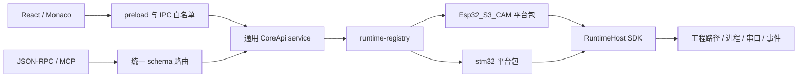

# 平台包与宿主架构

设备实现按平台归属。`extensions/boards/<platform>/` 组合该平台的配置、检测、工具链、构建、烧录、布局和驱动描述；`src/core` 提供通用宿主能力，不按厂商拼接工具命令。当前只有检测配置 `auto` 和具体平台 `Esp32_S3_CAM`、`stm32`。

## 目录责任

| 位置                             | 责任                                                              |
| -------------------------------- | ----------------------------------------------------------------- |
| `src/shared/contracts.ts`        | 跨进程数据、CoreApi、构建与检测结果类型                           |
| `extensions/types.ts`            | 纯配置 BoardAdapter：设备事实、默认值与校验                       |
| `extensions/runtime.ts`          | RuntimeHost、PlatformRuntime 与工厂 SDK                           |
| `extensions/boards/<platform>/`  | 平台 adapter/runtime/toolchain/programmer/layout/driver，按需拆分 |
| `extensions/registry.ts`         | 板卡配置和元数据的可信静态注册                                    |
| `extensions/runtime-registry.ts` | 具体平台 runtime 工厂的可信静态注册                               |
| `extensions/drivers/`            | 驱动类型与注册，厂商事实来自平台目录                              |
| `src/core/`                      | 通用锁、工程路径、配置、进程宿主、哈希、缓存、串口                |
| `src/renderer/`                  | 编辑器、设备能力显示、菜单、首选项、国际化                        |
| `src/automation/`                | 认证传输、schema 路由、客户端与 MCP                               |

平台 runtime 不导入 core 或另一个平台实现；类型来自 shared，宿主契约来自 `extensions/runtime.ts`。平台内部使用相对导入，复制完整目录即可保留内部依赖。纯 adapter 定义配置，有状态的工具与设备操作由 runtime 组织。

宿主还包含 Electron IPC、网页服务、日志导出和通用驱动安装执行器。这些基础设施不定义厂商 Flash 地址、FQBN、下载源或芯片识别规则。

## 调用流

核心维护工程选择、互斥与取消、文件保存、配置落盘、输入指纹、产物哈希和成功构建缓存，按 registry 分派平台。平台决定如何扫描、识别、安装、构建和烧录，返回统一结果。

## 宿主 SDK 与检测

RuntimeHost 提供带超时/取消的参数数组进程执行、受控工程路径解析、构建目录重建、源码读取、串口选择、事件、网络和取消信号。平台解析厂商输出；工程输入与可清理路径先经过宿主边界。平台内部归档可使用 Node 文件 API，但不得导入核心实现。

PlatformRuntime 包含 `status/install/discover/probe/build/flash/invalidate`；`sourceInputs` 声明源码编辑索引之外的固定输入，可选 buildInputs 返回编译器额外读取的源码、头文件与链接输入，用于完整指纹校验。`auto` 没有具体 runtime，而是汇总已注册平台候选：

- USB 串口只是候选，平台 probe 必须验证真实芯片。
- 多候选不默认取第一项；缺工具与没有设备分别报告。
- 未识别时容量为 0、分区为空，不开放构建、烧录和布局。
- 识别成功后平台产生配置，由核心校验、保存和清理缓存。

## 复制与注册

具体平台 manifest 声明 `entry`、`runtime`、`apiVersion` 和 `runtimeApiVersion`，当前运行时契约为 1。复制前必须匹配目标宿主的 SDK 与 shared 数据契约；版本字段不代表自动兼容协商。

1. 复制完整平台目录，包含工具链、协议、布局、驱动事实和说明。
2. 在 `extensions/registry.ts` 显式注册 adapter。
3. 在 `extensions/runtime-registry.ts` 显式注册 runtime 工厂；auto 只注册配置。
4. 需要驱动时，在 `extensions/drivers/index.ts` 注册平台导出的描述，补齐语言资源。
5. 执行类型、边界和隔离 bundle 检查，再单独记录硬件验证。

S3 与 STM32 已做单目录复制后的隔离打包检查，不依赖 core 或彼此目录。检查证明源码依赖边界，不能替代工具环境、接线、链接地址和硬件烧录验证。

所有平台随应用静态编译。当前不扫描工程文件夹并执行任意 JavaScript，没有目录热安装、热执行或第三方插件沙箱。修改 runtime 后需重建并重启主进程。

## 构建、缓存与能力

`be.build` 保存输入。右键“设为编译入口”只更新 `build.entry`，可选文件或目录，不立即编译；平台解释入口。构建使用已保存文件，输入、构建配置或产物变化会使缓存过期。串口号和传输速率不作为固件源码变化。

S3 平台生成、校验 ESP 布局与 CSV；STM32 不套用 ESP 分区，烧录模式限制从 Flash 起点写入单一固件，布局页因此只分配应用区，剩余 Flash 保留。`layout` 能力开放布局页，`partitions` 能力允许任意分区编辑；界面以 capabilities 决定编译、验证和布局动作，不以默认容量代替实测值。平台通过 `BoardDefinition.layout` 提供 Flash 起始地址，renderer 不按板卡 ID 分支。`flashSizeOverride` 表示用户手动修正容量，平台重新识别时不得覆盖；STM32 只接受不大于探测值的覆盖。STM32 链接以物理 Flash 生成完整镜像，但编译结果按应用区与数据/系统保留区逐段检查；越界会产生警告，烧录确认仍允许用户二次确认，超出物理 Flash 或 RAM 则拒绝。

STM32 源码构建仍需要匹配芯片的启动文件、链接脚本、架构选项和构建配置；不能从单个 main.c 推导全部板卡信息，具体范围以平台说明为准。

## 前端、驱动与协议

renderer 不导入 Node 或直接启动编译器，preload 只公开能力白名单。项目选择、原生日志另存为和 Windows 驱动安装属于桌面能力；网页端只报告“已发起下载”。首选项按常规、工具链和驱动定位，语言与驱动操作无需工程。

ST-Link 的 INF、USB ID 和归档描述位于 STM32 平台 driver.ts，通用执行器完成 PnP 查询、解压与显式提权安装。驱动可用不等于命令行工具已安装，调试器也不等于 COM 串口。

补全与资源管理器菜单是显式注册的纯数据。renderer 使用 zh-CN.json/en.json，automation 使用 zh-CN.json/en-US.json，外部工具输出保留原文。JSON-RPC routes.ts 是方法 schema 唯一映射，MCP 从同一表生成工具，不复制平台逻辑。详见 [AI-PIPE.md](AI-PIPE.md)。
