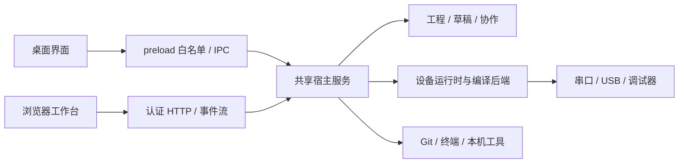

# 工程实现与交付

本文面向维护者、插件作者和部署者，说明工作台的数据流、模块边界、构建产物及签名流程。具体接口见[架构](ARCHITECTURE.md)、[运行时模块](RUNTIME-PLUGINS.md)和[通用扩展](GENERAL-EXTENSIONS.md)。

## 三种运行形态

| 形态            | 界面                | 宿主                           | 项目、工具与硬件位置 |
| --------------- | ------------------- | ------------------------------ | -------------------- |
| 桌面便携版      | Electron 内嵌工作台 | Electron 主进程                | 运行桌面应用的电脑   |
| Web 独立 EXE    | 用户浏览器          | 内置 Node.js 的单文件服务      | 运行 EXE 的目标电脑  |
| Web Node.js ZIP | 用户浏览器          | 目标电脑已有的 Node.js 24+ x64 | 启动服务的目标电脑   |

三种形态复用工程格式、平台实现及宿主服务。Web 浏览器的“打开文件夹”浏览目标电脑目录，串口、USB、Git、编译器和终端进程也在目标电脑执行。

Renderer 不直接执行编译器或系统命令。类型、请求参数与确认字段在共享契约和宿主路由中校验；独立调试窗口及扩展视图使用对应范围的接口。

## 模块化与二进制宿主

设备模块分为十个职责目录：`support`、`device`、`runtime`、`constraints`、`ui`、`compiler`、`debugger`、`layout`、`languages`、`tools`。清单声明支持芯片、传输协议、编译能力、工具需求、资源布局、语言和视图。

`package:runtime` 将 TypeScript 源码构建为独立 JavaScript 和资源目录。二进制宿主读取包内声明与相对路径，不要求用户安装宿主源码、TypeScript 或完整仓库。桌面发行包把设备模块放在 `resources/device-modules`，便于访问和单独分享；Web 发行包携带对应预构建模块。

通用扩展与设备模块分别管理。通用扩展可以贡献菜单、外观、窗口和底部面板，不必实现编译功能。官方 Personalization 示例拥有自己的语言清单和配置。

## 构建与工具选择

工程 `be` 文件保存入口、命名子工程及构建配置。编译与设备在线状态分离；只有访问硬件的操作需要连接。当前入口可选择 Debug／Release、体积优化、编译器家族与版本，并覆盖 C／C++ 的工具选择。

ESP32-S3 使用 Arduino CLI 与 Arduino-ESP32 平台。STM32 支持 GNU Arm GCC、Arm Compiler 5／6；启动文件、链接配置、芯片容量与语言能力由平台实现处理。第三方运行时可声明自己的编译器和工具。

成功构建记录源码依赖和固件产物。工程 ZIP 使用实际依赖信息迁移外部源码、头文件及库；工具链通过独立离线包管理。工具导出重新扫描清单与文件哈希，不复用旧归档。

## 界面状态与协作

文件、工具页和面板通过 `workspace-surfaces` 注册同步标识。宿主维护共享文档版本、关闭事务、连接成员和日志游标；修改携带起始版本，独立改动合并，冲突保留供用户处理。

关闭共享标签时，各端针对同一版本确认未保存内容。Web 撤销限定当前用户的变更，本地保留全局操作能力。外部 VS Code 保存通过同一文件监听和草稿冲突流程回到工作台。

语言属于客户端个人设置，不作为团队共享配置；语言清单集中注册，词条按需加载。详见[国际化](LOCALIZATION.md)。

## OBE 来源与完整性

`obe` 是 UTF-8 JSON 签名清单。它使用 Ed25519 签署确定性 JSON，绑定发布者、公钥指纹、类型、模块 ID、版本、签署时间以及每个文件的路径、大小和 SHA-256。

验证流程：

1. 解析清单并检查路径、重复项、容量和格式。
2. 使用清单公钥验证数学签名。
3. 将发布者公钥与宿主内置可信发布者表比较。
4. 从实际载荷重新计算每个文件哈希，检查新增、删除和修改。
5. 安装确认绑定当次内容指纹；写入前重新读取，变化后重新审查。

设备模块“正常”表示可信签名及内容一致；无签名或发布者未被认证显示“异常”；签名损坏或文件内容改变显示“危险”。第三方包导出保留原签名，不自动获得官方身份。

`obe` 不负责付费激活，不是编译器许可证。Blode Studio 的[永久免费承诺](FREE-SOFTWARE.md)与文件来源验证并行。

## 私钥与 Windows 签名

签发私钥保存在维护者 `.signing/`，排除 Git 与发行载荷。宿主仅携带公钥；更换或新增信任根需要发布新的宿主公钥表。快速签发工具为维护者本机文件，不随源码提交。

Windows EXE／DLL 的 Authenticode 与 OBE 分开：前者提供 Windows 发布者签名，后者用于 Blode 自己的包内容验证。当前维护者证书为自签名证书，未作为公开 CA 证书或 SmartScreen 信誉认证。

Web 单文件构建在运行时副本中移除原证书、注入 SEA 载荷，再追加发行签名；操作只针对构建副本。发行文件最终签名完成后，再计算 `.sha256` 和 `.obe`。任何后续修改均需重新生成对应校验与签名。

## 发行流水线

`build-release.bat` 接收四段版本号，调用共享构建脚本同步 npm 与 Windows 版本，依次生成三个 Windows x64 发行包。桌面使用隔离暂存目录，避免开发资源与发行打包互相覆盖；Web 宿主构建检查不包含 Electron 导入。

发行目录包含三个包、各自的 `.sha256`、存在维护者身份时的 `.obe`，以及 `SHA256SUMS`、`release-manifest.json` 和 `RELEASE-NOTES.md`。构建日志保留在 `.tools/`；不自动创建标签、上传或发布 GitHub Release。

## 验证范围

自动化检查覆盖参数边界、签名与篡改、离线导入导出、协作协议、语言完整性和构建元数据。类型检查及生产构建用于验证宿主、preload、界面资源和独立模块是否能一起生成。

硬件结果按具体平台和连接方式单独记录。Windows x64 为当前发行环境；Linux／macOS 的实现适配与实机验收分开记录，不以构建通过代替硬件验证。详见[平台支持](PLATFORM-SUPPORT.md)和[硬件验证记录](HARDWARE-VALIDATION.md)。
